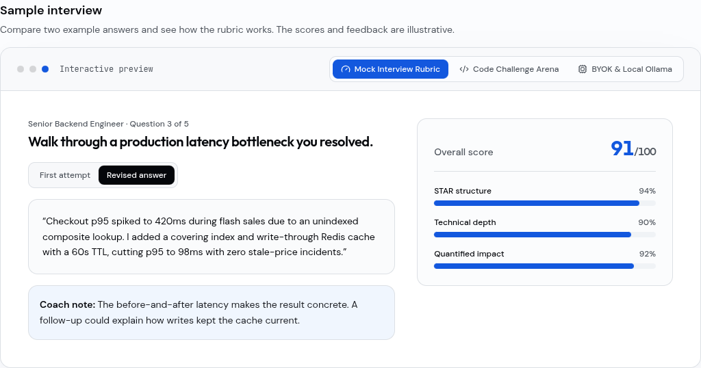
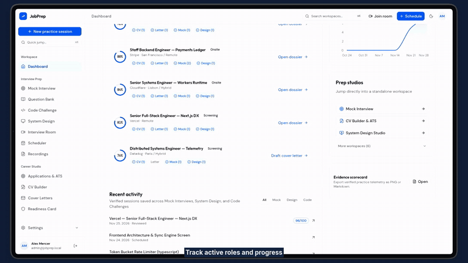
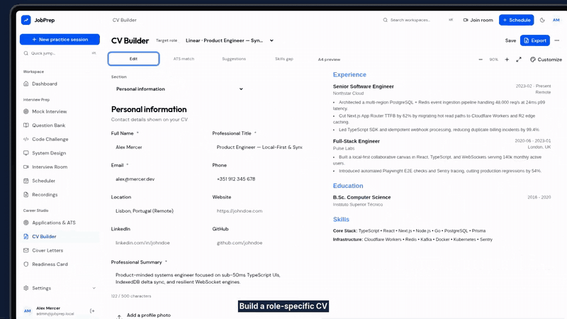
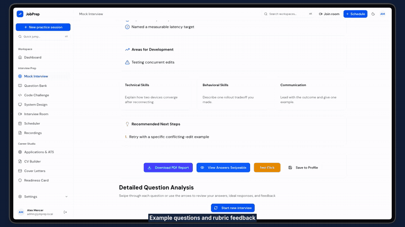

<div align="center">

# JobPrep

**Practice for a specific role.** Rehearse interview answers, get rubric-based feedback, and tailor your résumé in one workspace.

[](https://github.com/aliammari1/JobPrep/actions/workflows/ci.yml)
[](https://github.com/aliammari1/JobPrep/actions/workflows/codeql.yml)
[](LICENSE.md)
[](https://scorecard.dev/viewer/?uri=github.com/aliammari1/JobPrep)
[](https://github.com/aliammari1/JobPrep/stargazers)
[](https://github.com/aliammari1/JobPrep/pulse)
[](CONTRIBUTING.md)
[](https://www.conventionalcommits.org/)

[Quick start](#quick-start) · [Features](#features) · [Docs](#documentation) · [Contribute](CONTRIBUTING.md) · [Get help](SUPPORT.md) · [Report a bug](https://github.com/aliammari1/JobPrep/issues/new/choose)

</div>



> **License note:** JobPrep is [source-available](LICENSE.md), not OSI open source. Personal, educational and research use is free, and contributions are welcome. Commercial use needs a separate license.

## Watch the tour

A two-minute walkthrough of the whole app: set a target role, track applications, tailor a CV and cover letter, rehearse answers with rubric feedback, run coding and system-design practice, and use it on mobile and in the browser extension.

<video src="https://github.com/user-attachments/assets/7862ed91-6514-4706-a798-ada33810d060" controls muted playsinline width="100%"></video>

[▶ Open the video directly](https://github.com/user-attachments/assets/7862ed91-6514-4706-a798-ada33810d060) · It uses a seeded demo account; feedback and code results are illustrative, and the tour is silent and captioned.

## Why JobPrep

Generic interview prep is not tied to the job you are applying for. JobPrep keeps the role, your applications, your CV, and your practice sessions together, so feedback is judged against a rubric for that role.

## Features

| | |
| --- | --- |
| **Interview practice** | Generate role-specific questions and review feedback on your answers against a rubric. |
| **Applications** | Track roles and prepare for each one. |
| **CV builder** | Build a résumé with live preview and export it. Import from LinkedIn with the [browser extension](chrome-extension/README.md). |
| **Cover letters** | Tailor letters to a specific application. |
| **Technical rounds** | Coding challenges and a system design canvas. Code execution needs a configured runner. |
| **Video sessions** | Interview rooms on LiveKit, with an optional HeyGen avatar for mock interviews. |
| **AI Coach** | Choose a cloud provider (Anthropic, OpenAI, OpenAI-compatible) or run models locally with Ollama. |
| **Everywhere** | Installable PWA, Android TWA, and Chrome extension. |

### In action

| Dashboard | CV builder with ATS match | Interview feedback |
| --- | --- | --- |
|  |  |  |

### See it first

The home page has an interactive sample with two answers to one question. It uses fixed data and needs no account, AI key, or database. Run the app and open [`/#sample`](http://localhost:3000/#sample), or look at the [phone-sized view](docs/screenshots/mobile.png).

## Quick start

You need [Bun](https://bun.sh), Node.js 22.12+ (or 24.x), Git, `openssl`, and Docker (or your own PostgreSQL).

```bash
git clone https://github.com/aliammari1/JobPrep.git
cd JobPrep
cp .env.example .env              # then set BETTER_AUTH_SECRET: openssl rand -base64 32
bun install --frozen-lockfile
docker compose up -d --wait db    # PostgreSQL 16, same as CI
bunx prisma migrate deploy
bun run dev                       # http://localhost:3000
```

The sample page and most of the UI work **without an AI provider**. Sign up at `/sign-up`; the verification link prints in the dev server terminal when no email credentials are set. Stuck? See [common setup problems](CONTRIBUTING.md#common-setup-problems).

### Self-host with Docker

```bash
cp .env.example .env     # set BETTER_AUTH_SECRET, BETTER_AUTH_URL, NEXT_PUBLIC_APP_URL
docker compose --profile app up -d --build
```

PostgreSQL, migrations and the app start together on port 3000. See the [self-hosting guide](docs/SELF_HOSTING.md).

### Keep your data local

Run models on your own machine with [Ollama](https://ollama.com) so nothing leaves it. Set `OLLAMA_HOST` and `OLLAMA_MODEL` in `.env`; the steps and a table of what each provider receives are in [AI and privacy](docs/AI_AND_PRIVACY.md).

### Optional integrations

Add credentials to `.env` only for the feature you are working on. [`.env.example`](.env.example) lists every setting.

| Feature | Needs |
| --- | --- |
| AI generation | A cloud provider key, or a local Ollama server |
| Video interviews | LiveKit (HeyGen for avatars) |
| Code execution | An external runner |
| Billing, phone sign-in | Their own providers |

Cloud providers receive the input needed to generate a response and may charge for usage. Each integration has its own data flow, so check it before enabling it with real user data.

## Tech stack

Next.js 15 (App Router) · React 19 · TypeScript · Tailwind CSS 4 · PostgreSQL + Prisma · Better Auth · Vercel AI SDK · LiveKit · Biome · Vitest · Playwright · deployed on Cloudflare Workers via OpenNext.

## Project layout

```
src/app/            Next.js pages and API routes
src/components/     Shared and feature components
src/lib/            Database, auth, AI and shared logic
prisma/             Schema, migrations, seed
tests/              Vitest unit tests and Playwright e2e
chrome-extension/   Manifest V3 LinkedIn-to-CV importer
android-twa/        Android Trusted Web Activity wrapper
docs/               Engineering guides and decisions
docs-mintlify/      Public product guides
```

## Commands

```bash
bun run dev           # start the dev server
bun run lint:ci       # Biome lint + format check
bun run typecheck     # TypeScript
bun run test          # Vitest (needs no database or provider keys)
bun run test:e2e      # Playwright
bun run build         # production build
```

## Documentation

| Where to go | What you'll find |
| --- | --- |
| [Architecture](docs/ARCHITECTURE.md) | App boundaries, AI providers, engineering decisions |
| [Self-hosting](docs/SELF_HOSTING.md) | Run everything with Docker Compose |
| [AI and privacy](docs/AI_AND_PRIVACY.md) | What each provider receives, and a fully local setup |
| [Roadmap](docs/ROADMAP.md) | What is planned and where help is wanted |
| [Deployment](docs/DEPLOYMENT.md) | Cloudflare Workers, private R2 recordings, PostgreSQL, LiveKit |
| [API specification](openapi.json) | Schemas. Open `/api-docs` in a running app for the interactive reference. |
| [Browser extension](chrome-extension/README.md) | Local install and résumé import |
| [Product guides](docs-mintlify/) | Interviews, CV building, the AI Coach |

## Community

- **Contribute:** read [CONTRIBUTING.md](CONTRIBUTING.md). Small fixes and docs go straight to a PR, and [good first issues](https://github.com/aliammari1/JobPrep/labels/good%20first%20issue) are labeled.
- **Ask a question:** [GitHub Discussions](https://github.com/aliammari1/JobPrep/discussions). See [SUPPORT.md](SUPPORT.md).
- **Report a vulnerability:** privately, per [SECURITY.md](SECURITY.md). Do not open a public issue.
- **How decisions are made:** [GOVERNANCE.md](GOVERNANCE.md).
- **Be kind:** we follow the [Code of Conduct](CODE_OF_CONDUCT.md).
- **Using an AI coding agent?** [AGENTS.md](AGENTS.md) has the repo rules.

## Project health

- **Supply chain:** GitHub Actions are pinned by commit SHA; dependencies are updated weekly by Renovate and reviewed on every PR (dependency review).
- **Security scanning:** CodeQL, gitleaks, Trivy and OpenSSF Scorecard run in CI.
- **Quality gates:** Biome (zero errors enforced; a warning baseline is being burned down, see the [roadmap](docs/ROADMAP.md)), strict TypeScript, Vitest, Playwright and Lighthouse, with Conventional Commit PR titles driving automated releases.
- **Housekeeping:** inactive issues and PRs are closed after 74 days by a stale bot; `good first issue` and `help wanted` are exempt.

## License

[Source-Available License 1.0](LICENSE.md) · `LicenseRef-Source-Available-1.0`. Contact [Ali Ammari](mailto:contact@aliammari.dev) about commercial licensing.

Maintained by [Ali Ammari](https://github.com/aliammari1). If JobPrep helps you, a ⭐ helps others find it.
